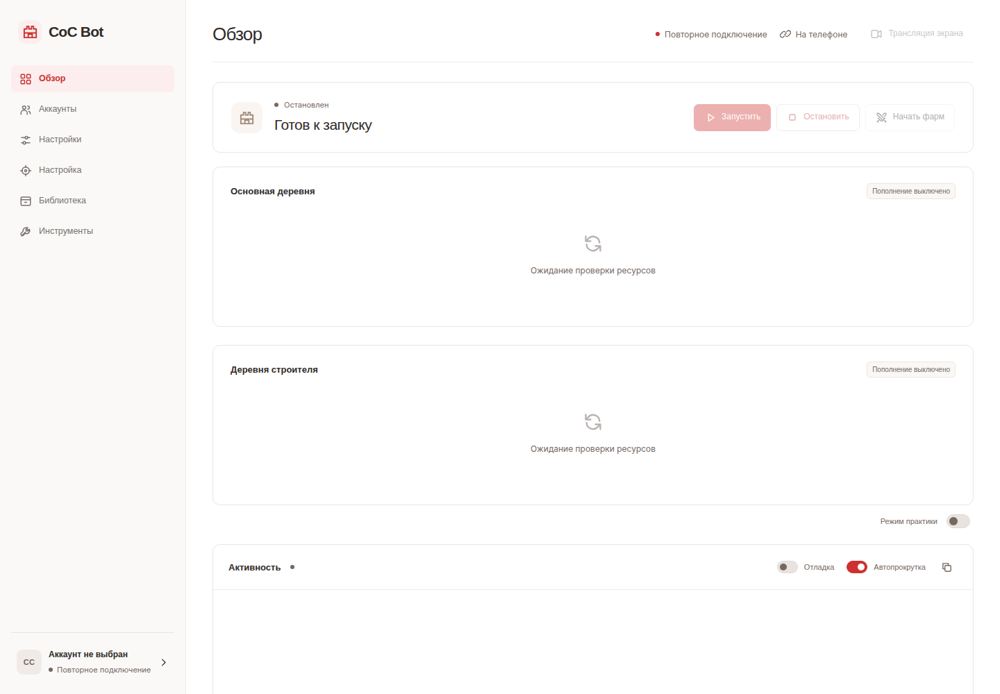

# CoC Bot

<picture></picture>

<strong>Самостоятельный проект на Python: компьютерное зрение для Clash of Clans и панель управления, доступная с компьютера или телефона в одной локальной сети.</strong>

> **Внимание: автоматизация может привести к постоянной блокировке аккаунта.** Supercell запрещает ботов и автоматизацию игрового процесса в своей [политике честной игры](https://supercell.com/en/safe-and-fair-play/). Учебная цель и тренировочный режим не делают использование автоматизации в живой игре разрешённым. Проект не связан с Supercell и не одобрен компанией.

Игра и бот работают на компьютере с Linux в Waydroid. Бот анализирует изображение экрана и отправляет нажатия через ADB. Веб-панель управляет пожертвованиями, атаками без рейтинга, необязательными улучшениями, калибровкой, ресурсами и диагностикой. Её можно открыть с телефона через браузер по Wi-Fi; удалённый рабочий стол для обычного управления не нужен. Трансляция экрана показывает игру в браузере и позволяет временно управлять ею вручную, когда автоматизация остановлена.

<picture></picture>

Снимок панели создан в офлайн-предпросмотре: игровой аккаунт и Waydroid не подключены.

## Содержание

- [Возможности](#возможности)
- [Совместимость и ограничения](#совместимость-и-ограничения)
- [Установка](#установка)
  - [Linux и браузер](#linux-и-браузер)
  - [Доступ по локальной сети](#доступ-по-локальной-сети)
  - [Пакет CasaOS](#пакет-casaos)
- [Первый запуск](#первый-запуск)
- [Повседневное управление](#повседневное-управление)
- [Атаки](#атаки)
- [Необязательные улучшения](#необязательные-улучшения)
- [Восстановление и резервные копии](#восстановление-и-резервные-копии)
- [Обновление](#обновление)
- [Решение проблем](#решение-проблем)
- [Разработка и проверки](#разработка-и-проверки)
- [Лицензия и вклад в проект](#лицензия-и-вклад-в-проект)

## Возможности

- **Пожертвования:** поиск кнопок «Пожертвовать» в клановом чате, проверка запроса и режима эликсира, поддержка конкретных и необязательных открытых или смешанных запросов. Учтены панели с разной вместимостью войск, заклинаний и осадных машин.
- **Атаки без рейтинга:** автоматические атаки Электродраконами, редактируемые сценарии с картой боя или последовательность нажатий. Автоматический режим и планировщик строят карту противника и проверяют действия размещения.
- **Улучшения:** обработка рекомендаций игры для зданий и лаборатории с учётом доступности, поддерживаемых названий, исключений и резерва ресурсов. Улучшения питомцев используют отдельную ячейку и по умолчанию выбирают незанятых питомцев. Просмотр и запуск улучшения — разные действия.
- **Веб-панель:** запуск и остановка, состояние пополнения ресурсов, журнал событий, адаптивные настройки, интерфейс Harbor, пошаговая калибровка и резервные копии калибровки.
- **Деревня строителя (экспериментально):** сбор и учёт золота и эликсира, пополнение ресурсов поддерживаемыми атаками, проверка улучшений зданий и исследований войск. Поддерживаются шесть Ночных ведьм с Боевой машиной или четыре одиночных Дракончика в разных лагерях. Бот проверяет обе стадии боя и экран результата перед возвратом в основную деревню. Сбор, атаки, улучшения и исследования имеют отдельные выключенные по умолчанию переключатели. Подробности — в [руководстве по деревне строителя](docs/BUILDER_BASE.md).
- **Восстановление:** незавершённые атаки и улучшения записываются, чтобы после перезапуска проверить состояние игры, а не повторять действия вслепую.
- **Автоматические защитные планировки:** необязательное удаление препятствий ради ресурсов, импорт встроенных планировок, размещение оставшихся предметов и проверенная активация в дополнительном слоте основной деревни. Нужны совместимая встроенная ссылка на копирование и распознавание стандартного ландшафта; для Ратуш 2 и 3 автоматическое копирование не поддерживается. См. [автоматические планировки](docs/AUTOMATIC_LAYOUTS.md).
- **Инструменты разработки:** необязательный сбор снимков, разметка и экспорт, офлайн-проверки и экспериментальный модуль наблюдения за распознаванием экрана.

## Совместимость и ограничения

Проект активно разрабатывается и проверяется на Linux-хосте с Ubuntu, Waydroid и браузерами в локальной сети. Распознавание рассчитано на англоязычный альбомный интерфейс игры. Другие языки, раскладки, разрешения, облики героев и декорации могут потребовать калибровки или привести к пропуску действия. Экспериментальная обучаемая модель записывает предсказания, но не управляет нажатиями.

## Установка

Выберите **установку Linux с браузерной панелью**, если Waydroid и Clash of Clans уже работают на компьютере. Выберите **пакет CasaOS**, если нужно поручить CasaOS управление приложением, а вспомогательному сервису на хосте — запуск Waydroid и игры. В обоих вариантах Android остаётся на компьютере с Linux, а браузер показывает изображение с него.

### Linux и браузер

Понадобится компьютер с Linux на основе Ubuntu или Debian, работающие Waydroid и Clash of Clans, права администратора для установки зависимостей и интернет для первоначальной загрузки. Перед калибровкой самостоятельно войдите в игру.

Откройте терминал и выполните:

~~~bash
sudo apt update
sudo apt install git
mkdir -p ~/Projects
cd ~/Projects
git clone https://github.com/MonkeyStud-lab/coc-donation-bot.git
cd coc-donation-bot
bash scripts/setup_linux.sh --web
source .venv/bin/activate
python -m pip install -e '.[web,web-live]'
python scripts/setup_live_view.py
python -m coc_bot.web
~~~

Установка добавит системные пакеты, создаст приватное Python-окружение <code>.venv</code> и загрузит зависимости распознавания и значки войск. Это может занять несколько минут. Скрипт **не устанавливает** Waydroid или Clash; настройка управляемого хоста описана ниже в разделе CasaOS.

Модуль трансляции загрузит закреплённый по версии Android-сервер scrcpy и проверит его контрольную сумму. Этот компонент нужен и автоматическим атакам с жестами камеры, даже если трансляция не открыта. Права root в Android не требуются.

На компьютере с Linux откройте **http://127.0.0.1:8765**. Не закрывайте терминал: закрытие вкладки браузера не останавливает сервер и бота. Чтобы снова открыть панель после остановки сервера:

~~~bash
cd ~/Projects/coc-donation-bot
bash scripts/run_web.sh
~~~

Перед подключением бота вручную запустите Waydroid и Clash. Дополнительные варианты запуска описаны в [руководстве по браузерной панели](docs/WEB_UI.md).

### Доступ по локальной сети

Узнайте локальный IP-адрес компьютера с Linux в настройках сети. Остановите локальный сервер сочетанием Ctrl+C, затем запустите его с этим адресом и соответствующим URL:

~~~bash
source .venv/bin/activate
python -m coc_bot.web --host YOUR_LINUX_IP --origin http://YOUR_LINUX_IP:8765
~~~

Вместо <code>YOUR_LINUX_IP</code> укажите один и тот же IP-адрес в обеих частях команды. Откройте этот URL в браузере телефона или другого устройства, подключённого к той же локальной сети. Используйте конкретный адрес приватной сети: запуск без пароля не разрешает привязку к универсальному адресу <code>0.0.0.0</code>.

**По умолчанию пароль не задан. Любой, кто получит доступ к панели, сможет управлять игрой и менять настройки.** Оставляйте панель только в доверенной сети и не открывайте её порт в интернет. Защита паролем, SSH-туннель и HTTPS описаны в [руководстве по браузерной панели](docs/WEB_UI.md#open-from-another-device).

### Пакет CasaOS

Пакет запускает браузерное приложение в Docker и использует вспомогательный сервис Linux-хоста для управления Waydroid. При запуске приложение подготавливает Android, подключает ADB и открывает Clash. Игровая автоматизация остаётся остановленной, пока вы не нажмёте **Запустить**.

Начальная конфигурация рассчитана на хост x86-64 с Ubuntu или Debian, systemd, совместимой поддержкой binder и работающей графикой; в первую очередь проверялись системы AMD/Intel. CasaOS и Docker должны быть установлены. В изолированной виртуальной машине проверены настройка чистой системы, установка APK и автоматическое восстановление фонового сервиса после перезагрузки, но Clash завершает работу во время запуска. Новая установка игры и другие конфигурации оборудования ещё требуют приёмочной проверки; пакет нельзя считать универсальным установщиком в один клик. См. [протокол проверки](docs/CASAOS_FRESH_INSTALL_TEST.md) и [руководство по фоновому режиму](docs/CASAOS_PACKAGE.md#headless-operation).

1. Склонируйте этот репозиторий на хост CasaOS командами выше.
2. В каталоге проекта соберите локальный образ:

   ~~~bash
   bash packaging/casaos/build.sh
   ~~~

   При сборке загружаются общедоступные изображения распознавания и ресурсы жестов. Сборка завершится ошибкой, если обязательные изображения для автоматических атак недоступны; профиль или кэш значков другого пользователя не нужен. См. [офлайн-проверку образа](docs/CASAOS_PACKAGE.md#build-and-install).

3. В CasaOS добавьте пользовательское приложение, импортировав файл [packaging/casaos/compose.yaml](packaging/casaos/compose.yaml).
4. Перед установкой проверьте сервис настройки хоста. Ему нужны права администратора для установки Waydroid, образов Android, графических компонентов и вспомогательной службы. Обычный контейнер бота работает без этих привилегий.
5. Откройте плитку приложения CasaOS. Адрес панели по умолчанию: <code>http://YOUR_LINUX_IP:8767</code>. Следуйте статусу запуска и подсказкам установки. Первый запуск Android может занять несколько минут; не закрывайте страницу статуса.
6. Для новой установки игры импортируйте собственный доверенный архив APK Clash, затем войдите в игру через **Трансляция → Взять управление**. APK игры и данные аккаунта не включены в репозиторий или образ контейнера.

Чтобы создать архив APK на компьютере, где уже установлена Clash, понадобятся Python 3, ADB и доступ к Android-устройству:

~~~bash
python3 scripts/export_clash_apks.py --device ANDROID_IP:5555 --output clash-apks.zip
~~~

Замените <code>ANDROID_IP</code> адресом Android-устройства. Архив содержит установочные файлы, включая разделённые APK, **но не** аккаунт или игровые данные.

Если Waydroid уже установлен, настройте его подключение или импорт **до** установки, чтобы не создавать конкурирующий контроллер. [Руководство CasaOS](docs/CASAOS_PACKAGE.md) описывает подключение существующей сессии, импорт профиля, проверку совместимости, привилегии и восстановление запуска. Документированный способ установки предполагает локальную сборку образа; наличие опубликованной версии в реестре не гарантируется.

## Первый запуск

1. **Подготовьте игру.** Войдите в аккаунт и откройте основную деревню. При ручной установке Linux выполните <code>waydroid status</code>, чтобы узнать IP-адрес устройства. В разделе **Настройки → Дополнительно** задайте **адрес ADB**: адрес с окончанием <code>:5555</code>, затем сохраните. CasaOS настраивает адрес при запуске.
2. **Проверьте подключение.** Выберите **Инструменты → Устройство → Проверить устройство**. При ручной установке помогут команды терминала:

   ~~~bash
   adb connect ANDROID_IP:5555
   adb devices
   ~~~

   Замените <code>ANDROID_IP</code>. Подключённое устройство должно иметь статус <code>device</code>.
3. **Откалибруйте интерфейс.** Остановите автоматизацию и завершите ручное управление. Выберите **Настройка → Настроить отсутствующее**. Для каждого элемента панель укажет, какой экран игры открыть. Снимите экран, нажмите запрошенную кнопку или выделите нужную область, затем сохраните. Можно выбрать отдельный элемент напрямую; пропуск или отмена сохраняют прежнюю калибровку. Отдельный редактор изображений не нужен.
4. **Проверьте выбор ресурса для пожертвований.** Откройте реальный запрос на пожертвование и выберите эликсир. Откалибруйте позицию кнопки эликсира и элемент **Индикатор выбранного эликсира**, включая рамку или фон выбранной кнопки. Если режим нельзя проверить, пожертвование не выполняется.
5. **Сохраните копию калибровки.** В **Библиотеке** выберите **Создать копию калибровки**, затем нажмите **Экспорт**, чтобы сохранить копию на другом устройстве. Перед восстановлением создаётся резервная копия текущего состояния.
6. **Наблюдайте за первым запуском.** Нажмите **Запустить** и проследите за реальным запросом. Убедитесь, что бот его открывает, меняет количество войск и возвращается в клановый чат. Отдельно проверьте атаки и улучшения, прежде чем включать их расписание.

Сохраняйте разрешение и раскладку Android такими же, как при калибровке. Изменение размера браузера не меняет размер изображения Android. После обновления игры сохраните профиль и повторно откалибруйте изменившиеся элементы.

## Повседневное управление

- **Обзор:** запуск, остановка, кнопка **Начать фарм**, тренировочный режим, показания ресурсов и единый журнал событий. Трансляция игры доступна с любой страницы.
- **Аккаунты:** сохранение текущей деревни, добавление Supercell ID, переключение между аккаунтами и выбор роли каждого. См. [Аккаунты](docs/ACCOUNTS.md).
- **Настройки:** категории пожертвований, цели пополнения ресурсов, улучшения, интервалы и лимиты сбора. Подсказки к полям открываются по запросу; разделы **Дополнительно** и **Разработка** сохраняют отдельные настройки.
- **Настройка:** пошаговая калибровка или переход к отдельному элементу. В разделе **Дополнительно** находятся элементы для старого интерфейса и резервные настройки. Последовательность размещения отображается обычно только для соответствующего метода атаки.
- **Библиотека:** вкладки калибровок и снимков экрана, резервные копии, профили, импорт и экспорт ZIP-архивов, переименование, удаление и галерея собранных снимков.
- **Инструменты:** проверка устройства и экрана, текущий снимок, тесты навигации, предварительный просмотр улучшений, отчёты и управление игрой/сессией. В **Инструменты → Атаки** находятся карта противника, просмотр армии, пользовательские сценарии и запуск под наблюдением.

Кнопка **Остановить** прерывает обычную работу, отдельные атаки и инструменты. Clash остаётся открытой, незавершённый бой бот за вас не заканчивает. **Закрыть Waydroid и Clash** — отдельное действие в инструментах. Закрытие вкладки браузера не останавливает автоматизацию.

Настройки можно менять во время работы. Кнопка **Сохранить и перезапустить** проверяет изменения, дожидается завершения текущего пожертвования или атаки и перезапускает бота с новыми параметрами. **Остановить** отменяет отложенный перезапуск. Когда бот остановлен, кнопка **Сохранить** применяет настройки без запуска автоматизации. Перед сохранением завершите ручное управление.

Браузерный интерфейс **Harbor** использует чёрные, кобальтовые и латунные оттенки, абстрактные обои и полупрозрачные боковую и основную панели. Переключение страниц происходит без анимации. При уменьшенной прозрачности и повышенной контрастности панели становятся непрозрачными. См. [описание Harbor](docs/UI_INTERFACES.md).

Автоматический фарм зависит от уровня ресурсов, а не от таймера. Бот не планирует перерывы на основе длительности сессии и не закрывает Clash по времени работы. Старые настройки перерыва и сохранённые сроки перерывов игнорируются. Остановить бота и восстановить его после сбоя можно в любое время.

**Тренировочный режим — не симулятор.** Он пропускает обычные нажатия пожертвований, но не запрещает навигацию, инструменты или атаки в настоящей игре. Для тестов без подключения к игре используйте описанный ниже офлайн-предпросмотр.

### Трансляция экрана

**Трансляция** на странице обзора использует WebRTC-видео вместо частого опроса снимков экрана. Просмотр доступен во время автоматизации; чтобы нажимать или проводить по экрану, сначала остановите бота, затем выберите **Взять управление**. Перед запуском бота, калибровкой или другим инструментом завершите ручное управление. Его завершение само по себе не перезапускает автоматизацию.

Одновременно поддерживается только один видеопоток и один контроллер. Для видео нужен работающий кодировщик Android и разрешённое локальное соединение WebRTC. В качестве альтернативы выберите **Инструменты → Устройство → Текущий снимок** или **Открыть игру**. См. [настройку трансляции](docs/WEB_UI.md#experimental-live-video).

## Атаки

Автоматическое пополнение ресурсов атаками **по умолчанию выключено**. Исходный метод — **Последовательность нажатий**; другой метод нужно явно выбрать в настройках. Кнопка **Начать фарм** на странице обзора использует выбранный метод. Расширенная карта боя и редактор сценариев доступны в **Инструменты → Атаки**.

### Автоматические атаки Электродраконами

Этому режиму не нужны сохранённая последовательность нажатий или нарисованная вручную карта. Используется один встроенный массовый сценарий Электродраконов — бот не придумывает отдельную тактику для каждой базы:

1. Возвращается в деревню, открывает бой без рейтинга и подтверждает армию.
2. Проверяет независимые элементы управления боем, прежде чем считать соперника готовым.
3. Уменьшает масштаб и осматривает перекрывающиеся части экрана, чтобы построить карту границы размещения.
4. Читает состав и количество армии по подходящим свежим снимкам.
5. Размещает Электродраконов вдоль отмеченного края, направляет внутрь заклинания Ярости, затем размещает осадную машину и доступных героев. Способности героев нажимаются после проверки их размещения.
6. Проверяет размещение по уменьшению счётчиков или состоянию карточек войск. Сомнительное нажатие на карте вслепую не повторяется.
7. Распознаёт результат, возвращается домой, восстанавливает камеру и проверяет клановый чат.

Поддерживаются армии с Электродраконами, необязательными заклинаниями Ярости, одной совместимой осадной машиной и максимум четырьмя распознаваемыми героями. Неизвестная карточка, неподдерживаемое заклинание вроде Возврата, несогласованные счётчики или неполная карта блокируют размещение. Если матч начат, но армия не поддерживается, бот завершает его как пропущенный и устанавливает паузу перед новой попыткой, а не запускает тот же неподходящий состав снова.

Портреты героев общие для зарегистрированных аккаунтов. В проекте есть стандартные портреты Короля, Королевы, Хранителя, Королевского чемпиона и Принца-миньона; проверенные пользователем облики сохраняются и используются остальными аккаунтами. Уровни героев и значки питомцев не включаются в обучаемые изображения. Доступность и размещение всё равно проверяются на экране текущего боя; общий портрет не переносит на другой аккаунт армию или план атаки. Нераспознанный облик не используется до отдельной проверки.

Если включён параметр **Аккаунты → Проверять чат между задачами**, бот проверяет чат после каждой задачи, обрабатывает запросы и продолжает работу. Аккаунты переключаются на следующую деревню в безопасных точках задачи; отдельное время дежурства донора не требуется. Незавершённые проверки продолжаются при следующем посещении. Ограничения полного ресурса, задержки после неудачных атак и проверки затрат продолжают действовать.

Для работы нужны подключение, калибровка навигации, изображения войск и закреплённый сервер жестов. Поддерживаются не все армии и декорации. Перед включением расписания проверьте одну атаку.

Для пополнения ресурсами выберите **Автоматически** в параметре **Настройки → Метод атаки**, включите **Пополнять ресурсы основной деревни** и сохраните изменения. Завершите ручное управление и нажмите **Запустить**. Пороги **Начинать пополнение ниже (%)** и **Пополнить до (%)** по умолчанию равны 75% и 95%. Бот должен надёжно распознавать ресурсы и реальную вместимость хранилищ и проверяет их после каждого боя. Режим работает с одним или несколькими аккаунтами. Если счётчики не читаются или атаки не приносят ресурс, пополнение откладывается, пока продолжаются другие задачи посещения. Старые интервалы фарма больше не запускают атаки по таймеру.

### Пользовательские сценарии и последовательность нажатий

**Планировщик** позволяет проверить или исправить состав армии, изучить карту противника и редактировать упорядоченные шаги размещения войск, заклинаний, способностей и ожидания. Сохранённый сценарий можно добавить в расписание только после пробного запуска под наблюдением; изменение сценария снимает это подтверждение. Подготовка противника начинает настоящий бой, поэтому время разведки продолжает идти, пока вы редактируете план.

**Последовательность нажатий** повторяет нажатия на слоты армии и карту, записанные через **Настройка → Фарм → Последовательность размещения**. Настройки перемещения камеры и случайного изменения нажатий для фарма относятся только к этой фиксированной последовательности. Требуются соответствующие панель армии, положение камеры и калибровка.

Все три метода следят за одновременным появлением **Вернуться домой** и **Войска израсходованы** на двух свежих снимках экрана результата. При обычном завершении боя остаётся калиброванный запасной таймер на случай ошибки распознавания, но при распознанном результате бот обычно не ждёт окончания всего таймера. См. [руководство по атакам](docs/ATTACK_REBUILD.md) и [проверки завершения боя](docs/BATTLE_COMPLETION.md).

## Необязательные улучшения

Для новой деревни параметр **Настройки → Улучшения → Развитие деревни** включает строительство до улучшений, подготовку армии по подтверждённым открытиям и свободному месту в лагерях, приоритет исследования войск для фарма и проверку завершения зданий перед улучшением Ратуши. Этот пробный режим проверяется начиная с Ратуши 2; более поздние уровни и автоматическое изменение заклинаний полностью не проверены. Перед включением ознакомьтесь с [развитием основной деревни](docs/HOME_PROGRESSION.md).

Автоматизация улучшений зданий, исследований и питомцев **по умолчанию выключена**. Для безопасной проверки сначала остановите бота и выберите **Инструменты → Улучшения → Здания / Исследование войск / Питомцы → Проверить улучшения**. Проверка читает доступные варианты, не тратя ресурсы. **Начать рекомендованное улучшение** — отдельное действие с подтверждением и повторной проверкой данных.

Чтобы включить автоматическую работу, отметьте категории в **Настройки → Улучшения**. Бот проверяет наличие строителей, лаборатории или свободной ячейки питомца, поддерживаемую рекомендацию, стоимость, валюту и баланс. Резерв задаётся как минимальный остаток **после оплаты**. Можно резервировать строителей и исключать названия из списка.

Резерв строителей и ресурсов по умолчанию равен нулю; необязательные ограничения можно задать в разделе **Дополнительно**. Перед долгими атаками для пополнения бот проверяет строителей и возвращается в чат после каждого подтверждённого улучшения. Незавершённое посещение вторичной деревни продолжится позже, чтобы донор не оставался вдали от запросов надолго. На странице аккаунтов отображаются результат по категории, время проверки и причина отложенного улучшения.

Для улучшений питомцев используется отдельная ячейка и резерв тёмного эликсира. По умолчанию разрешены только незанятые питомцы. Параметр **Разрешить улучшение экипированных питомцев** вынесен отдельно, потому что улучшаемый питомец может быть недоступен для атаки.

Без режима «Развитие деревни» исключены стены, герои, Ратуша, покупка новых зданий, снаряжение и несколько зданий производства армии. В режиме развития деревни бот может улучшать проверенные стены группами, сохраняя резерв ресурсов. Здания и исследования должны находиться в списке рекомендаций; у питомца должны быть проверены имя, назначение и стоимость.

Этот механизм не разрешает тратить самоцветы или магические предметы и не позволяет покупать недостающие ресурсы. Если результат траты нельзя подтвердить, новая покупка блокируется, пока незавершённое действие не будет сверено с игрой. См. [правила и исключения улучшений](docs/UPGRADES.md).

## Восстановление и резервные копии

Прогресс атаки записывается до отправки игровых команд. После прерывания бот проверяет текущий экран, а не воспроизводит размещение войск или применение способностей. Он дожидается подтверждённого боя, визуально проверяет уход с экрана результата и проверяет деревню, положение камеры и клановый чат перед завершением незаконченной операции. При восстановлении атаки не используется обычный таймер возврата домой: без визуального подтверждения бот приостанавливается. Для трат на улучшения действует отдельный журнал незавершённых действий.

В CasaOS три неудачных снимка экрана запускают проверку восстановления. Бот приостанавливает нажатия и проверяет, отвечает ли оболочка Android, пока служба графики недоступна, и только затем перезапускает сессию Waydroid. Ошибка видеозахвата может запросить ту же проверку. Перед продолжением бот повторно проверяет захват и восстанавливает ранее запущенную автоматизацию по существующим журналам атак и покупок. **Остановить** отменяет восстановление и запрещает автоматический запуск. Перезапуск ограничен двумя попытками в час с пятиминутной паузой. Неподтверждённые сбои требуют ручной проверки; восстановление не переустанавливает Android и не сбрасывает калибровку или игровые данные.

Если восстановление ожидает проверки, осмотрите игру и журналы. Не удаляйте файлы восстановления только для того, чтобы принудительно запустить атаку или покупку. Кнопка **Остановить** сохраняет информацию о незавершённой операции. См. [восстановление атаки и диагностические файлы](docs/ATTACK_REBUILD.md#interrupted-attacks-and-diagnostic-storage).

Для обычной установки Linux постоянные файлы хранятся в каталоге проекта; в CasaOS — в <code>/DATA/AppData/coc-bot/profile</code>:

- <code>data/calibrated.yaml</code> и <code>data/templates/</code> — калибровка и эталонные изображения.
- <code>data/user_settings.yaml</code> — сохранённые настройки отдельно от файлов настроек в репозитории.
- <code>data/attack-planner/</code> — сценарии, проверенные изображения и состояние восстановления.
- <code>data/upgrades/</code> и <code>data/runtime_state.json</code> — история улучшений и расписания.
- <code>data/collection/</code> — необязательный набор снимков для разработки.
- <code>data/debug/</code> — созданная диагностика, обзорные изображения и журналы операций.

Экспорт калибровки из библиотеки **не является** полной копией игры или аккаунта. При переносе настроек и сценариев сохраните весь профиль отдельно. Настройка хоста CasaOS создаёт проверенные копии установки в <code>/DATA/AppData/coc-bot/backups</code>. Данные Android, Waydroid и аккаунта остаются на хосте и не входят в резервные копии бота.

Журналы ротируются при достижении 10 МБ, срок хранения — семь дней. Сгенерированная диагностика атак удаляется между операциями с ограничениями: семь дней, 1 ГБ и 40 групп с сохранением трёх последних групп каждого типа. Из-за этого каталог может превышать целевой размер. Очистка приостанавливается во время восстановления атаки или камеры; калибровки, резервные копии и проверенные наборы данных не удаляются.

Сбор снимков экрана — отдельная необязательная функция. По умолчанию сохраняется не больше 200 изображений в день по UTC и 5 ГБ; дубликаты пропускаются, а при достижении лимита места проверенные данные не удаляются. Снимки, разметка, обученные изображения и данные аккаунта **не загружаются на GitHub автоматически**. Перед передачей архива проверьте его на имена игроков, сообщения чата и данные устройства. См. [сбор данных](docs/SMART_COLLECTION.md) и [разметку](docs/ANNOTATION_WORKFLOW.md).

## Обновление

### Обновление бота

Сначала остановите автоматизацию, завершите ручное управление и экспортируйте резервную копию калибровки. При установке из исходников остановите веб-сервер сочетанием Ctrl+C и выполните:

~~~bash
cd ~/Projects/coc-donation-bot
git pull --ff-only
bash scripts/setup_linux.sh --web
source .venv/bin/activate
python -m pip install -e '.[web,web-live]'
python scripts/setup_live_view.py
python -m coc_bot.web
~~~

Для доступа из локальной сети передайте прежние параметры <code>--host</code> и <code>--origin</code>. После запуска обновите страницу браузера. Обычное обновление сохраняет приватные настройки и калибровку. Если Git сообщает о конфликтующих локальных изменениях, сохраните копии этих файлов и разрешите конфликт — не сбрасывайте их принудительно.

Для CasaOS команда <code>git pull</code> сама по себе не обновляет работающий образ. Скачайте исходный код, пересоберите образ командой <code>bash packaging/casaos/build.sh</code>, затем пересоздайте сервис **bot** с установленной конфигурацией Compose и новым образом. Сохраните переменные окружения, подключение профиля и параметры сессии хоста. Для обновления только кода повторно запускать привилегированную настройку хоста не требуется. Оставьте предыдущий образ для отката: пересборка приложения не обновляет отдельно установленный вспомогательный сервис хоста. Обновление службы описано в [руководстве CasaOS](docs/CASAOS_PACKAGE.md).

### Обновление Clash of Clans

После установки из доверенного источника CasaOS при запуске управляемой среды проверяет, доступны ли более новые APK Clash. Также можно остановить бота и выбрать **Инструменты → Система → Обновить Clash**. Для обновления используется сторонний источник APK; перед установкой проверяются пакет, версия и сертификат подписи. Clash не удаляется, игровые данные не очищаются. Для первоначальной установки всё равно нужен доверенный архив APK; импорт остаётся запасным вариантом.

После обновления игры проверьте интерфейс и предварительно просмотрите затронутые действия перед запуском автоматизации. Обновление APK не меняет калибровку и не гарантирует совместимость распознавания. См. [сведения об обновлении игры](docs/CASAOS_PACKAGE.md#updating-clash) и [совместимость интерфейса](docs/UI_COMPATIBILITY.md).

## Решение проблем

- **Нет соединения с Android:** проверьте <code>waydroid status</code>, подключитесь к правильному адресу и убедитесь, что <code>adb devices</code> показывает <code>device</code>. Затем нажмите **Проверить устройство**.
- **CasaOS не запускается:** проверьте статус среды и причину сбоя, затем повторите запуск после её устранения. Устаревшее состояние Waydroid может потребовать перезапуска <code>waydroid-container.service</code> администратором хоста; не сбрасывайте Android и не удаляйте Clash.
- **Запуск заблокирован:** проверьте отсутствующую калибровку, активное ручное управление, второй процесс бота или ожидающее восстановление. Android одновременно может контролировать только одна операция.
- **Пожертвование пропускается:** проверьте выбор эликсира, текст кнопки «Пожертвовать», допустимость запроса и калибровку сетки реальной панели. Не отключайте проверки ресурсов ради нажатия.
- **Атака пропускается или завершается раньше времени:** изучите отчёт об армии, карте и журнал событий. Неизвестные карточки и неполные данные о границе намеренно блокируют размещение.
- **Не нажимается «Вернуться домой»:** откалибруйте элемент на настоящем экране результата. Увеличение таймера не исправит координаты.
- **Зависает трансляция:** проверьте частоту кадров и сообщения об ошибках, затем повторите запуск. Свежий снимок поможет отличить сбой видео от остановки игры.
- **Настройки не применяются:** нажмите **Сохранить** или **Сохранить и перезапустить**. При конфликте сначала перезагрузите настройки, затем редактируйте снова; перед сохранением завершите ручное управление.
- **Сообщение об ошибке:** экспортируйте журнал событий и скачайте отчёт через инструменты. Приложите видимый экран, ожидаемое действие и фактический результат. Перед отправкой удалите приватные данные аккаунта и чата.

## Разработка и проверки

Код Python находится в <code>src/coc_bot/</code>. Игровая логика разделена между <code>donation/</code>, <code>attack/</code>, <code>upgrades/</code> и <code>vision/</code>; за расписания, владение ресурсами и хранение отвечает <code>runtime/</code>. Общие сервисы находятся в <code>control/</code> и <code>calibration/</code>. Маршруты FastAPI — в <code>src/coc_bot/web/</code>, исходники React/TypeScript — в <code>web/</code>.

Собранные файлы браузерной панели хранятся в <code>src/coc_bot/web/static/</code>, поэтому для обычной установки Node.js не нужен. После изменения интерфейса пересоберите его:

~~~bash
cd web
corepack pnpm install --frozen-lockfile
corepack pnpm run build
cd ..
~~~

Добавьте пересобранные ресурсы вместе с изменениями интерфейса.

Обычная установка использует Tesseract и OpenCV, без EasyOCR и Torch. Улучшенное распознавание вместимости необязательно; команда <code>bash scripts/setup_linux.sh --web --ocr</code> установит и подготовит его. Необязательная сборка образа CasaOS описана в [руководстве участника проекта](docs/CONTRIBUTING.md).

Для офлайн-проверок Python:

~~~bash
source .venv/bin/activate
python -m pip install -e '.[web,web-test]'
python -m unittest discover -s tests -v
python scripts/verify_farm_offline.py
python scripts/verify_smart_collection.py
python scripts/verify_battle_completion.py
~~~

Для тестов используйте отдельные профили, а не действующую калибровку. Чтобы открыть панель с поддельным устройством и без настоящих команд ADB:

~~~bash
PYTHONPATH=src python scripts/preview_web_offline.py
~~~

Прежний интерфейс Tkinter доступен командой <code>python -m coc_bot.main</code>; запуск только из терминала — <code>python -m coc_bot.main --no-gui</code>. Интерфейсы используют общий движок и формат профиля, но новые инструменты планировщика и предварительного просмотра улучшений доступны в браузере. Перед переключением интерфейсов остановите активный контроллер.

Дополнительная документация:

- [Настройка браузерной панели и управление](docs/WEB_UI.md)
- [Пакет CasaOS и интеграция с хостом](docs/CASAOS_PACKAGE.md)
- [Планировщик атак, автоматический фарм и восстановление](docs/ATTACK_REBUILD.md)
- [Распознавание завершения боя](docs/BATTLE_COMPLETION.md)
- [Рекомендации по улучшениям и защитные проверки](docs/UPGRADES.md)
- [Архитектура](docs/HOW_IT_WORKS.md) и [проверки надёжности](docs/RELIABILITY.md)
- [Сбор снимков](docs/SMART_COLLECTION.md), [разметка](docs/ANNOTATION_WORKFLOW.md) и [исследования распознавания](docs/PERCEPTION.md)
- [Дополнительные параметры запуска](docs/RUNNING.md) и [участие в разработке](docs/CONTRIBUTING.md)

## Лицензия и вклад в проект

Код распространяется по лицензии [MIT](LICENSE). Сопровождающие проекта не помогают обходить обнаружение, зарабатывать на ботах, прокачивать аккаунты или продавать их. Приветствуются вклады в надёжность, удобство, документацию и исследования компьютерного зрения — в соответствии с [правилами участия](docs/CONTRIBUTING.md).
